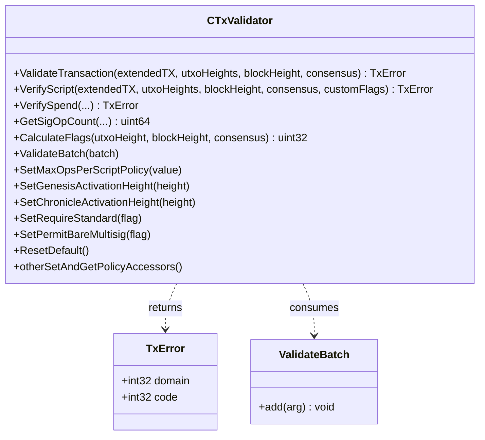

# Object Model

This page describes the public API of the BDK core validation engine, `bsv::CTxValidator`
(`core/txvalidator.hpp`, `core/txvalidator.cpp`), and the Go type that wraps it.

`CTxValidator` is the single entry point for transaction and script validation. Its public **C++**
API includes:

- **validation**: `ValidateTransaction`, `VerifyScript` (which takes an **optional `customFlags`**
  span — `core/txvalidator.hpp`, `VerifyScript`), and `ValidateBatch`;
- **single-input verification**: `VerifySpend`, with ordinary transaction bytes, input index, previous locking script and amount, heights, mode, and optional flags;
- **helpers**: `GetSigOpCount`, `CalculateFlags`;
- **individual checks**: `CheckStandardness`, `CheckPrevOutputs`, `CheckOutputs`, `CheckConsensusSigops`, `CheckSigOpsPolicy`, and `IsFreeConsolidation`;
- a large family of **policy accessors** (`Set*` / `Get*`), e.g. `SetMaxOpsPerScriptPolicy`,
  `SetMaxScriptNumLengthPolicy`, `SetMaxScriptSizePolicy`, `SetMaxPubKeysPerMultiSigPolicy`,
  `SetMaxStackMemoryUsage`, `SetGenesisActivationHeight`, `SetChronicleActivationHeight`,
  `SetMaxTxSizePolicy`, `SetMaxSigOpsPolicy`, `SetMaxSigOpsPostGenesisPolicy`,
  `SetMinMiningTxFee`, `SetDataCarrier(Size)`, `SetRequireStandard`, `SetPermitBareMultisig`,
  the consolidation-policy setters, `ResetDefault`, and their `Get*` counterparts.

> **Note:** there is **no** separate `VerifyScriptWithCustomFlags` method in C++ — the C++
> `VerifyScript` already accepts an optional `customFlags` argument. The Go binding
> (`module/gobdk/script/txvalidator.go`) splits that single C++ method into two convenience
> functions, `VerifyScript` and `VerifyScriptWithCustomFlags`.

Both `ValidateTransaction` and `VerifyScript` take a `consensus` boolean that selects the
policy (peer/mempool) vs. consensus (block) path — see
[Architecture overview](architecture.md#the-validation-engine-a-single-validatetransaction-entry-point)
and [VerifyScript](verify_script.md).

The diagram abbreviates the `VerifySpend` argument list: `transaction`, `inputIndex`,
`lockingScript`, `sourceSatoshis`, `utxoHeight`, `blockHeight`, `consensus`, and
`customFlags`. `GetSigOpCount` takes `extendedTX`, `utxoHeights`, `blockHeight`,
`countP2SHSigOps`, and `consensus`. `ValidateBatch` returns `std::vector<TxError>`, one result per batch entry.

`TxError` contains two 32-bit integers: `domain` and `code`. Domain values are `OK` (0), `SCRIPT` (1), `DOS` (2), `EXCEPTION` (3), `ABI` (4), and `CANCELLED` (5). Go maps success to `nil`, script errors to `ScriptError`, DoS errors to `DoSError`, exception results to `ScriptError` with `SCRIPT_ERR_CGO_EXCEPTION`, ABI results to `ABIError`, and cancelled results to `*CancelledError`. An unknown domain produces a generic Go error. Inspect both fields when debugging.

`SCRIPT` and `DOS` are verdicts about the transaction. `EXCEPTION` and `ABI` are not: they report that this process could not carry out the call, and a consumer must classify them as a local fault rather than as an invalid transaction. `ABI` is produced only by the language bindings, never by the core validator, and means a buffer length could not be expressed at the C boundary. `CANCELLED` is not a verdict either: the caller cancelled the call before it reached one (see below).

### Cancellation

Long-running validation can be cancelled. `ValidateTransaction`, `VerifyScript`, `VerifySpend`,
`ValidateBatch` and `CheckStandardness` each have an overload that takes a
`task::CCancellationToken`. Cancellation that leaves necessary verification unfinished returns
`CANCELLED` with code 0, in consensus and policy mode alike. A completed verdict is retained: all
inputs passed, or a real failure and every lower input finished. The token is polled only at fixed points:

| Call | Polls | Not polled (each linear in the transaction size) |
|---|---|---|
| `ValidateTransaction` | entry; after deserialising; after the transaction-level, prevout and output checks; in policy mode when inputs are checked for standardness (non-standard outputs not accepted), before each input; after building the shared signature-hash data, before the scripts | deserialising and hashing; the transaction-level, prevout and output checks; the output standardness, sigop, input-value and fee checks and building the shared signature-hash data; setting up each input's script check |
| `VerifyScript` | entry; after deserialising; after building the shared signature-hash data | deserialising and hashing; the argument checks and building the shared signature-hash data; setting up each input's script check |
| `VerifySpend` | entry; after deserialising; after building the shared signature-hash data | deserialising and hashing; the input-index and unconfirmed-input checks, copying the locking script and building the shared signature-hash data |
| `CheckStandardness` | entry; after deserialising; before each input's check when inputs are checked | deserialising and hashing; the output standardness check |
| `ValidateBatch` | as `ValidateTransaction`, per entry | as `ValidateTransaction` |

On top of these, the interpreter polls before every opcode it runs (SV Node's own check), before each
signature of `OP_CHECKMULTISIG` and each chunk of `OP_LSHIFT` / `OP_RSHIFT`. A step that has
started finishes before the next poll: one signature hash, one hash or big-number opcode, or any
phase in the right-hand column. A token that fires after the last poll leaves the call to return its
verdict, so callers must act on the result rather than on whether they cancelled. A cancelled
`ValidateBatch` keeps the results of the entries it finished and returns `CANCELLED` for the rest.

In parallel `ValidateTransaction` / `VerifyScript` jobs, the caller also polls before claiming
another input while work remains. There is no poll after the job drains. Cancellation of an input
above an established lowest failure does not replace that verdict; cancellation leaving a lower
input unfinished prevents reporting a higher failure. The serial loop keeps its existing poll sites.

`VerifyScript`, `ValidateTransaction` (including each `ValidateBatch` entry) and
`VerifySpend` count the calling thread against the shared core budget from after the
entry cancellation poll until return. Deserialization, transaction hashing,
transaction-level checks and shared signature-hash precomputation are included;
helpers are admitted only against the remaining budget.

The caller's token is read only on the calling thread, including parallel verification. In a parallel job the caller
polls between its own input claims and in its interpreter, and publishes observed cancellation to
an atomic job flag. Helpers poll that flag rather than the caller's token. A
`task::CThreadTimedCancellationSource` created on the calling thread therefore measures caller CPU, excluding helper CPU.
Helpers stop at their next interpreter poll after the caller observes cancellation; while the
caller only waits for helpers, it does not poll the token again.

The token belongs to the call, not to the `CTxValidator`, so concurrent calls on one validator
cancel independently. The C bindings take a pointer to a caller-owned `int32_t` instead of a token
(`bsv::MakeFlagCancellationToken`, `core/cancellation.hpp`): any thread cancels by storing a non-zero
value atomically, and the call reads it only until it returns. The existing signatures are
unchanged and never return `CANCELLED`.

## Parallel input helpers (process-wide)

`ValidateTransaction`, `VerifyScript` and `ValidateBatch` verify a transaction with 16 or more
inputs on the calling thread plus idle helper threads from one process-wide pool; the result is
always the serial one. Two free functions in `core/txvalidator.hpp`, not members of
`CTxValidator`, limit how many helpers verify at once, for the whole process:

- `bsv::SetParallelInputHelpers(int64_t helpers)`: `helpers < 0` automatic (the default: up to
  one helper per CPU the process may use, minus one), `0` no helpers (every transaction verified
  on its caller, no helper thread started), `> 0` at most that many, never more than automatic.
  Safe to call at any time from any thread.
- `bsv::GetParallelInputHelpers()`: the setting, `-1` for automatic.

Helpers only take cores that BDK's own threads leave idle, but they do not see other threads in
the process, such as goroutines. A lower limit leaves more CPU to them at the cost of slower large
transactions. Go: `script.SetParallelInputHelpers` / `script.GetParallelInputHelpers`. Rust:
`rust_bdk::set_parallel_input_helpers` / `rust_bdk::parallel_input_helpers`. The WASM build has no
helpers and does not expose the setting.

## Go binding

The Go type `script.TxValidator` (`module/gobdk/script/txvalidator.go`) is a thin cgo wrapper that
holds an opaque pointer to a C++ `CTxValidator` and exposes transaction validation, script
verification, batching, flag/sigop helpers and policy accessors. It provides both `VerifyScript`
and `VerifyScriptWithCustomFlags` over the single C++ `VerifyScript` method, but does not expose
`VerifySpend` or the individual checks listed above. It translates
the returned `TxError` into a Go `error` (`nil` on success, otherwise the error mapping described above). A finalizer calls the C++ destructor when the Go object is garbage-collected.

`ValidateTransactionContext`, `VerifyScriptContext`, `VerifyScriptWithCustomFlagsContext` and
`ValidateBatchContext` take a `context.Context` and stop when it is done. A cancelled call returns a
`*CancelledError`: `errors.Is(err, script.ErrCancelled)` is true, and its `ContextCause()` method returns
`context.Cause(ctx)`, so `context.Canceled`, `context.DeadlineExceeded` or a custom cause can be told
apart. It has neither `Cause()` nor `Unwrap()`: `github.com/pkg/errors.Cause(err)` returns the cancelled
result itself, and `errors.As` never finds a `ScriptError`,
`DoSError` or `ABIError` in a cancelled result, even when the cause is one. The context sets a heap `int32` through
`context.AfterFunc`. For contexts built by the `context` package no goroutine runs unless the context
is cancelled; for another `Context` implementation `AfterFunc` watches it with one goroutine until the
call returns. A context whose `Done()` is nil, such as `context.Background()` or `context.TODO()`,
takes the plain path at no extra cost.

`ValidateTransaction` rejects coinbase transactions. The caller must supply accurate previous-output data and heights; this API does not look up the node's UTXO set. See [Debugging transaction validation](debug_transaction.md).
